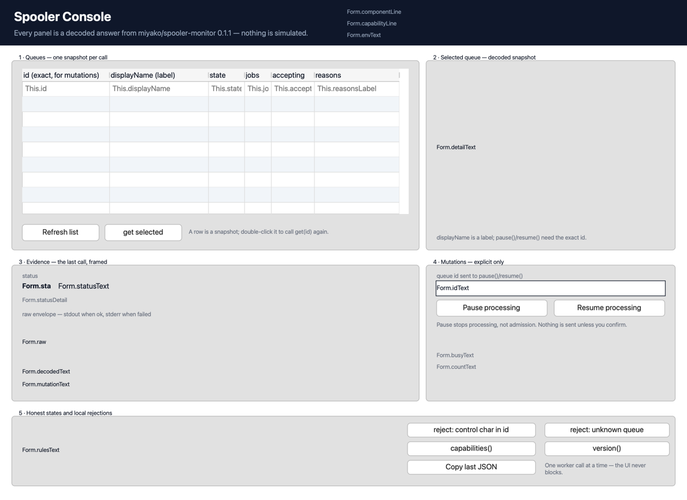
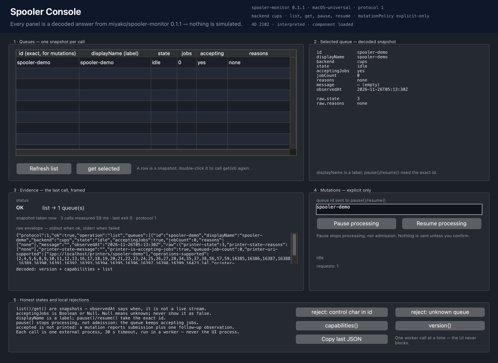

# spooler-monitor-demo

An interactive 4D console for [miyako/spooler-monitor](https://github.com/miyako/spooler-monitor) 0.1.1.
Every panel shows a decoded answer from the component's bundled CLI — nothing on
screen is simulated, cached or prettified.





## What the console demonstrates

| Panel | What it shows | Component call |
| --- | --- | --- |
| 1 · Queues | One row per queue: exact `id`, `displayName`, `state`, `jobCount`, `acceptingJobs`, `reasons` | `list()` |
| 2 · Selected queue | The decoded snapshot for one queue, including `observedAt` and the raw CUPS attributes | `get(id)` |
| 3 · Evidence | The status badge, the raw envelope as the CLI wrote it (stdout on success, stderr on failure), the decoded error and the mutation outcome | any |
| 4 · Mutations | The exact id that will be sent, plus pause/resume behind a confirmation dialog | `pause(id)` / `resume(id)` |
| 5 · Honest states | Two deliberate rejections, the capability matrix and a copy-to-clipboard of the last raw envelope | `capabilities()`, `version()` |

Points the demo is built around:

- **A list is a snapshot, not a stream.** The header says when the snapshot was
  taken (`observedAt`), and nothing polls in the background.
- **Two different identities.** `displayName` is a label; `pause`/`resume` need
  the exact `id`. The mutation panel shows the id it will send before anything is
  sent, which is why the preset "unknown queue" button exists.
- **Accepted is not printed.** A mutation envelope carries `accepted`,
  `outcome` (`accepted`/`rejected`/`uncertain`) and an `observation`; only the
  observation is evidence that the queue actually changed.
- **Local rejections have no process behind them.** `invalid_argument` returns
  before launch, so there is no `exitCode` at all. The console prints
  "no process" instead of inventing a zero.
- **Errors are double-wrapped.** The CLI writes a JSON error object to stderr and
  exits nonzero; the component decodes it a second time. Both layers are visible
  in the evidence panel.
- **The UI never blocks.** The component is synchronous with a 30 s cap, so calls
  run in a `CALL WORKER` worker and the form only applies finished payloads.

## Run it

Requirements: 4D 21.2 LTS (observed with build 100694) on macOS.

1. Stage the dependency, either way:

   ```sh
   python3 scripts/fetch_dependency.py     # release 0.1.1, SHA256 pinned
   ```

   or open the project and let 4D's Dependency Manager resolve
   `Project/Sources/dependencies.json`.

2. Open `Project/spooler-monitor-demo.4DProject` and run **Spooler ▸ Open Spooler
   Console** (or the `Start` method). The window opens first, then one worker call
   reads `version()`, `capabilities()` and `list()`.

3. If the host has no printers, `list()` legitimately returns
   `{"protocol":1,"ok":true,"operation":"list","queues":[]}`. The console explains
   that state instead of showing fake rows. To get rows to click:

   ```sh
   python3 scripts/demo_queue.py --create     # local file:///dev/null queue
   python3 scripts/demo_queue.py --remove
   ```

The queue helper only registers a local CUPS queue whose device discards
everything; it prints nothing and can be removed again.

## Headless acceptance

```sh
python3 scripts/verify.py
```

`scripts/verify.py` runs `Demo_SelfTest` under `tool4d`, reads the JSON report it
writes, and prints one line per check. The default matrix is read-only: nothing
is paused, resumed or printed.

```
passed  version reads 0.1.1 with protocol 1
passed  capabilities name backend, operations, explicit-only policy
passed  list returns a queue collection
passed  unknown queue is unknown_queue, exit 3, not_submitted
passed  invalid id is rejected locally, before any process
passed  a foreign target is refused before launch
passed  get returns the same id with an observation time
not_run pause/resume stay unexercised (explicit only)
not_run Windows-x64 CLI + winspool backend        macOS host
not_run Intel 4D host                            Apple Silicon host
not_run dependency-manager installation           release staged locally
```

Mutations are opt-in and never run on their own:

```sh
python3 scripts/verify.py --mutate spooler-demo
```

`docs/console-static.png` is the form template as `fourdform` draws it;
`docs/console-runtime.png` is a live capture with the full 4D application
(`--startup-method console_screenshot`). `tool4d` cannot open a form window, so a
runtime capture there is not possible — see finding 2 in the skills reference.

The `tools/` binaries (`4dform`, `4dlsp`) come from
[miyako/skills](https://github.com/miyako/skills) and are not committed.

## Chokepoints, fails and findings

These are the things that cost time or surprised me; each is reproducible from
this repository.

1. **`tool4d` does not install project dependencies.** A run prints
   `PackageManager No component to fetch dependencies` and
   `Dependency 'spooler-monitor' cannot be found`, yet the project still loads the
   component from `Components/`. The demo therefore ships an explicit staging
   script and never relies on the manager in headless runs.

2. **The compiler cannot resolve the component's class store.** With the component
   staged (packed release *and* an unpacked source copy), the analyzer and the
   compiler both report `The class cs.SpoolerMonitor is unknown` for a literal
   `cs.SpoolerMonitor.Queue` reference — including a typed `property tool :
   cs.SpoolerMonitor.Queue`. The sibling `DateTime-demo` hits the same wall. This
   demo keeps the project compile-clean with bracket access:

   ```4d
   $queue:=cs["SpoolerMonitor"]["Queue"].new(This.target)
   ```

   The trade-off is real: no compile-time checking of method names, so typos
   surface at runtime. Guard the constructor with a local `ON ERR CALL` and treat
   a missing component as an honest `component_unavailable` failure.

3. **`exitCode` arrives as a Real, not a Longint.** `Value type($result.exitCode)=Is longint`
   silently hides every exit code, which made the unknown-queue check fail with
   `exitCode: null` even though the CLI exited 3. Accept `Is real`, `Is longint`
   and `Is integer` through one helper (`isNumber`), and decide "no process" from
   the `launched` flag, not from a type test. The same applies to `seq`, which
   travels inside an object to the worker and back.

4. **Mutations can be refused by the host, and that is not a demo bug.** On this
   macOS host both fresh queues answered `pause`/`resume` with exit 5
   `backend_unavailable`, `outcome:"uncertain"`, `nativeCode:4096`,
   `"local CUPS request failed without an IPP response"`. The CLI reports the
   uncertainty instead of claiming success — exactly the case the mutation panel
   is designed to display. `pause` had succeeded in an earlier session, so treat
   this as environment-dependent and never assume a mutation succeeded because the
   request was accepted.

5. **A hard-coded white page breaks in dark appearance.** The first version forced
   a white page; with the system in dark mode the buttons and list header drew
   light-on-light and were unreadable in the capture. The page now follows
   `prefers-color-scheme` in `styleSheets.css`: every text object carries a colour
   class, the list uses a class-driven `alternateFill`, and nothing is hard-coded
   in `form.4DForm` (a JSON value would beat the stylesheet). Only the dark
   appearance was captured; the light rules are not_run on a live window.

6. **`Application version` returns `2102`, not `21.2`.** The header prints the raw
   string; do not parse it as a dotted version.

7. **`JSON Stringify($value; *)` is pretty-printing**, not compactness, and
   `LOG EVENT(Into system standard outputs; ...)` is the only reliable stdout from
   a headless method. `QUIT 4D` at the end of every CLI method, or `tool4d` waits
   for the 30 s timeout.

8. **`CONFIRM` is a procedure.** It returns nothing and reports the choice in
   `OK`; the optional arguments are the OK then the Cancel button titles.
   `If (Not(CONFIRM(...)))` is wrong. The dialog needs a person, so the
   confirmation path was not exercised headlessly (not_run).

9. **A list box drops its selection when the collection is replaced.** With
   `currentItemPositionSource: Form.selectedPos`, every `Form.queues:=...` resets the
   position to 0, so after a refresh the detail panel still described a queue while
   **get selected** answered "No row selected". Headless runs cannot show this: it
   was found by clicking the live form. `selectCurrent()` now falls back to
   `selectedQueue`, and `receive()` re-selects the row with `LISTBOX SELECT ROW`.

## Status matrix

| Check | Status | Evidence |
| --- | --- | --- |
| tool4d 21.2 source acceptance, macOS arm64 | passed | `scripts/verify.py`, 7 checks |
| Full 4D runtime capture, macOS arm64 | passed | `docs/console-runtime.png` |
| Live UI clicks, macOS arm64 | passed | refresh, get, version, capabilities, both rejections, copy, confirm Cancel and OK; light appearance not_run |
| Form schema (4dform `boon`) + LSP validation | passed | `.agents/schemas/4dform/formsSchema.json` |
| `pause`/`resume` on this host | failed | exit 5 `backend_unavailable`, `uncertain` (see finding 4) |
| Windows-x64 CLI / winspool backend | not_run | no Windows host |
| Intel 4D host | not_run | Apple Silicon only |
| Dependency-manager installation | not_run | release staged locally by script |
| Signing / notarization | not_run | out of scope for a demo |

## Repository layout

```
Project/Sources/Classes/SpoolerConsole.4dm      view model, all decoding
Project/Sources/Forms/Console/                  form, form method, object methods
Project/Sources/Methods/QueueWorker.4dm         worker that calls the component
Project/Sources/Methods/Demo_SelfTest.4dm       headless matrix
Project/Sources/Methods/console_screenshot.4dm  docs capture (full 4D only)
scripts/fetch_dependency.py                     release staging + SHA256
scripts/verify.py                               headless acceptance
scripts/demo_queue.py                           optional scratch CUPS queue
```

## License

MIT, see [LICENSE](LICENSE). The component is a separate work by the same author.
